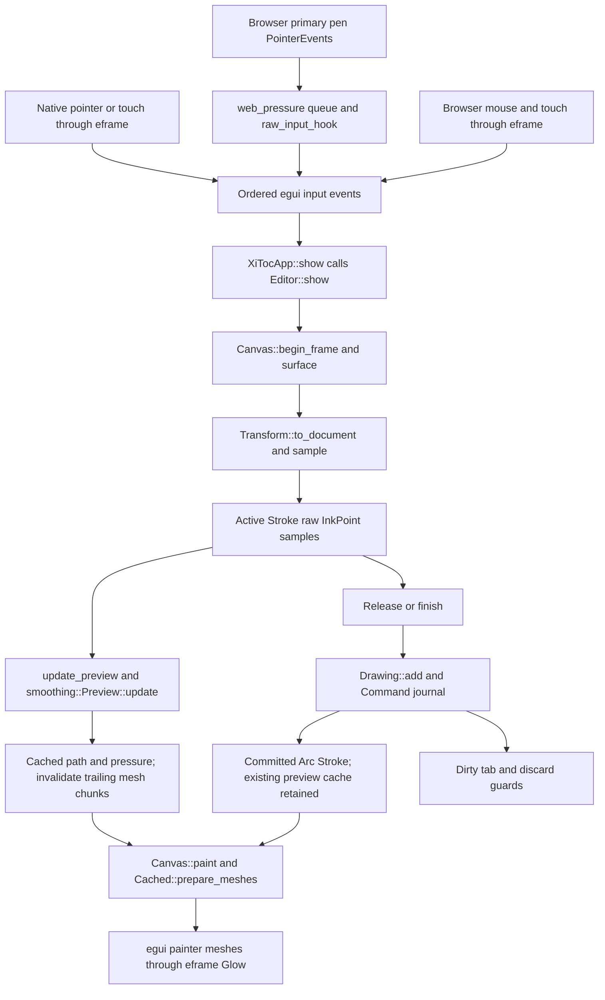

# XiToc codebase guide

This implementation map began with an audit of main `8fc0f94` (2026-11-02,
including PR #29) and includes the subsequent Selection/Lasso Escape follow-up.
It describes implemented source, not the entire product roadmap.
See [architecture decisions](ARCHITECTURE_DECISIONS.md) for constraints and
[development log](DEVELOPMENT_LOG.md) for evidence of how the code evolved.
[ARCHITECTURE.md](ARCHITECTURE.md) retains milestone contracts;
[TEST_PLAN.md](TEST_PLAN.md) contains historical verification and manual procedures.

## Current capability boundary

XiToc edits vector handwriting in memory on Page Notes and Whiteboards. Pen
presets, smoothing, pressure where delivered, both erasers, selection/lasso,
move/proportional resize, clipboard operations and undo/redo are implemented.
Rotation has a live group handle and 15-degree Shift snapping; explicit z-order
changes remain domain APIs without Arrange controls. Cut and arrow-key nudges are
implemented alongside the existing clipboard and manipulation commands.
Stroke and Shape are implemented canvas-object content types. Shapes include
rectangle, rounded rectangle, circle, ellipse, triangle, diamond, line and arrow.

The PDF codec creates and reopens **blank** native documents. It does not save or
reload handwriting. Dirty drawing disables browser PDF export; Ctrl/Cmd+S explains
the M2 limitation. Ordinary PDFs open as read-only with no PDF preview renderer.
Connectors, text, sticky notes, formulas, images, multipage creation,
browser directory handles, ink autosave and crash recovery remain planned.

## Crate and module map

The repository is one binary crate, `xitoc`, not a Cargo workspace or a library
with `src/lib.rs`. Semantic boundaries are Rust modules, not separate crates.
[Cargo.toml](../Cargo.toml) uses edition 2024, minimum Rust 1.95, exactly pinned
egui/eframe 0.37.0, and eframe's Glow rendering and persistence features.
`Cargo.lock` records transitive versions. No application backend is configured.

| Source | Responsibility and principal types/functions |
| --- | --- |
| [main.rs](../src/main.rs) | Module declarations, native `main`/`run_native`, WASM `WebRunner::start` |
| [app.rs](../src/app.rs) | `XiTocApp`, `Opened`, `Pending`; `show`, `act`, `open`, `refresh`, `creation_dialog`, preference persistence and discard guards |
| [document.rs](../src/document.rs) | `DocumentData`, `DocumentKind`, `Layout`, `PageGeometry`, `Viewport`, `Document`, `Location`, `pdf_filename` |
| [editor.rs](../src/editor.rs) | `Editor`; layout, page scrolling, Whiteboard navigation/grid, calls into `Canvas` |
| [drawing.rs](../src/drawing.rs) | `Stroke`, `InkPoint`, `Surface`, `PressureStyle`, `Smoothing`, `Transform`, `Drawing`, private `Command`; semantic mutations/history |
| [object.rs](../src/object.rs) | `CanvasObject`, `ObjectId`, `ObjectType`, `ObjectSnapshot`, `ObjectBounds`, `Placement`, `hit_stroke_path` |
| [canvas.rs](../src/canvas.rs) | `Canvas`, `Tool`, `Gesture`, `Erasing`, `Cached`, `PartialPreview`, `RotationPreview`; ordered input, previews, cached mesh rendering |
| [canvas_selection.rs](../src/canvas_selection.rs) | Private `canvas::selection_ui` submodule via `#[path]`; `SelectionGesture` and additional `impl Canvas` methods for selection/clipboard/previews |
| [selection.rs](../src/selection.rs) | UI-independent `Selection`, `SelectionCommand`, `Membership`, `LassoRegion`, `rectangle_matches`, `move_by`, `scale_about` |
| [shape.rs](../src/shape.rs) | UI-independent `Shape`, `ShapeGeometry`, `ShapeKind`, `ShapeStyle`, vector contours, hits/regions and local handle edits |
| [canvas_shapes.rs](../src/canvas_shapes.rs) | Shared-controller shape draft input, endpoint/corner adapters and view-keyed mesh caching |
| [object_clipboard.rs](../src/object_clipboard.rs) | `ObjectBundle`; capture, bounded validation/encode/decode, paste/duplicate with fresh IDs |
| [smoothing.rs](../src/smoothing.rs) | Incremental `Preview::update`, `path`; local adaptive quadratic geometry/pressure |
| [partial_erase.rs](../src/partial_erase.rs) | `Cuts`, `PartialCut`, `clip_segment`, `clip_tapered`, `path_pressures`, `fragments` |
| [eraser_index.rs](../src/eraser_index.rs) | `EraserIndex`; revision-keyed object hierarchy, path-block hierarchy and bounded spatial queries |
| [pen.rs](../src/pen.rs) | `PenType`, `PenStyle`, `PenPreset`, `Presets`; validated style library and lifecycle |
| [settings.rs](../src/settings.rs) | `Preferences`, `DrawingPreferences`, `Theme`; migration, validation, eframe storage adapter |
| [pdf.rs](../src/pdf.rs) | In-memory `encode`/`decode` for blank PDF 1.7 and named edit attachment |
| [storage/mod.rs](../src/storage/mod.rs) | Shared `Entry`, `Folder`, `Loaded`; cfg-selected storage adapters |
| [storage/native.rs](../src/storage/native.rs) | `Workspace`; selected-root capability, load/scan/create, `write_new_in` |
| [storage/web.rs](../src/storage/web.rs) | Async import/export fallback and `Event` completion messages |
| [web_pressure.rs](../src/web_pressure.rs) | WASM-only primary-pen PointerEvent bridge; `install`, `inject` |
| [ui/mod.rs](../src/ui/mod.rs) | Presentation modules and `Action` routing contract |

`document`, `drawing`, `object`, `pen`, `selection`, smoothing and clipping operate
without egui or filesystem/browser APIs. `settings` includes framework storage;
it is not a pure domain module. `canvas` deliberately combines input and egui
rendering. `storage/web` also takes an egui context to wake the app on completion.
These are current boundaries, rather than the proposed directory tree in older docs.
`index.html` also confines Ctrl/Cmd+A/D browser defaults to the canvas and cancels
native drags originating on it: otherwise browser page selection/bookmark behavior
can steal the editor's drag/release stream. It does not suppress Copy/Cut/Paste,
text-agent input shortcuts or incoming external dragover/drop events.

## Bootstrap, state and frame lifecycle

Native `main` calls `eframe::run_native` with a 1100×760 initial viewport and
480×360 minimum, constructing `XiTocApp::new(cc.storage)`. WASM `main` starts a local
async task, finds `#xitoc-canvas` in [index.html](../index.html), starts `WebRunner`,
and installs the pen bridge. Startup removes the loading status on success or
shows a WebGL-related failure message. [Trunk.toml](../Trunk.toml) builds locked
Rust dependencies; local URLs use `/`, Pages builds override this with `/XiToc/`.

`XiTocApp` implements eframe 0.37's `App::ui`, not the older `App::update` API.
`ui` calls `show`, then `persist_preferences`; `save` stores application
preferences, **not notes**. `persist_egui_memory` returns false. On WASM,
`raw_input_hook` injects queued pen samples before the shared controller runs.

Main app state comprises:

- Application preferences, Settings dialog, write-permission guard/warnings and
  a preference-change timestamp.
- Explorer `Folder` tree, selected creation folder, open `Vec<Opened>`, active
  tab index, creation dialog and status text. Each `Opened` has original `Loaded`
  bytes/document and a separate `Editor`.
- Chrome/tab presentation state and pending close/workspace/quit confirmation.
- Native `Option<Workspace>`, or WASM session `browser_files` plus an mpsc
  sender/receiver for async import/export completion.

`show` polls browser events, guards native close requests, applies the theme,
builds menus/status/Explorer and the document area, dispatches actions, then shows
creation/Settings/discard dialogs. Settings or pending discard disables the
underlying editor. Canvas shortcuts defer when egui text input is focused.
Switching tabs finalizes active ink/erase gestures; transient selection transforms
are cancelled by `Canvas::finish`.

## Documents, identity and storage

### Semantic data versus editor session

`DocumentData` schema 1 has private `schema_version`, UUID `document_id` and
`layout`. Kind derives from `Layout`; there is no independently mutable type
switch. `blank(Page)` creates one 210×297 mm A4 page. `blank(Whiteboard)` creates a
viewport centered at zero, zoom 1, with grid enabled. Validation currently permits
only one default A4 page or valid Whiteboard settings (zoom 0.1–8).

`Document` wraps data, a `Location` string and an `external` read-only marker.
Paths are locators, not native-note identity. `Loaded` retains original bytes as
`Arc<[u8]>`; cloned browser cache/tab entries share the byte buffer. An external
PDF without XiToc metadata receives a fresh Page `DocumentData` on decoding; that
classification UUID is temporary and is not a persistent identity from the file.

The `Editor` owns its own viewport/grid/navigation and `Canvas`; `Canvas` owns
`Drawing`. Ink is not a field in schema-1 `DocumentData`. Changing camera, grid,
selection or pen does not update the PDF attachment. There is no saved-ink revision.

### Creation and opening

Native actions call `Workspace::choose/open`, `scan`, `load` or `create` through
`app.rs`. `pdf_filename` validates a single portable filename (including reserved
Windows names); creation chooses type once. `create` encodes blank data and
publishes a fully written file without replacing an existing filename.
`open` deduplicates tabs by location and refuses to replace dirty ink when source
bytes changed. Native `refresh` rescans and follows uniquely matched document
UUIDs after external moves. Missing/ambiguous/unreadable clean tabs can close;
dirty tabs are retained even if source files changed or vanished.

Native storage uses `cap_std::fs::Dir` rooted at the user-selected directory.
Relative paths reject traversal/non-normal components and symlinks; subsequent
IO remains capability-relative. Scans are synchronous, capped at 4096 entries and
32 nested levels, skip symlinks, require UTF-8 names and decode discovered PDFs
to classify them. `write_new_in` writes a unique temporary file, syncs bytes,
atomically hard-links the destination with no-clobber semantics, removes the temp,
and syncs the directory on Unix. This is **new blank-file publication**, not an
implemented atomic update/save mechanism. Unsupported hard links fail safely.

Web uses `rfd::AsyncFileDialog`, `spawn_local` and channel events. Import checks
file size before reading its ArrayBuffer, decodes it and adds a flat session entry;
duplicate names are rejected. Creation builds blank bytes in memory and requests
export. Export writes original bytes through the dialog adapter. Completion means
the dialog/write path completed; the status explicitly asks users to confirm any
browser download and does not certify permanent storage. No directory handles,
recursive disk scanning or note uploads exist. Closing/reopening session tabs can
reuse original bytes; browser reload loses the session list and ink.

### PDF boundary and data safety

`pdf::encode` uses `pdf-writer` to emit one blank A4 page and an EmbeddedFiles name
tree entry `XiToc/document.json` containing schema-1 JSON. Whiteboards also use this
finite blank A4 viewer fallback. `decode` uses strict `lopdf` parsing, rejects
unsupported/encrypted/corrupt input, validates metadata and detects duplicate
attachments. Limits are 16 MiB input/parser decompression, 64 KiB edit payload,
and attachment traversal depth 16/budget 256 nodes.

Without the attachment, readable PDFs classify as external Page documents.
Recognized metadata is still read-only unless the codec's conservative blank-page
check succeeds: one page, an empty content stream and no `Annots` entry. This is
not general PDF graphics rendering or proof that arbitrary third-party edits
preserve XiToc data. Unknown schema/fields are errors, not silent blank fallback.

`Drawing::dirty` tests whether committed ink is nonempty; `Canvas::dirty` also
includes active pen samples. Thus returning to empty ink returns to the blank
baseline. Dirty close/workspace/quit paths prompt before discard; WASM publishes
`xitocHasUnsavedChanges` for `beforeunload`. Forced termination or suppressed
browser prompts can still lose ink. No recovery journal, note autosave or PDF ink
save is implemented. M2 must version the complete editable snapshot and emit
matching visible graphics/resources and edit data inside the same PDF.

## Coordinates and ownership

Page geometry is millimeters; stroke points/widths use PDF points (72/inch),
converted by `POINTS_PER_MM = 72 / 25.4`. `Surface::Page(usize)` is explicit
page-local ownership; `Surface::Canvas` is Whiteboard ownership. Page ownership
is never inferred from position. Page indices are not stable PageIds for future
page reordering.

`drawing::Transform` maps document points to logical screen points:

```text
screen = origin + (document - center) * scale
```

Subtracting centers in f64 before egui f32 conversion preserves local precision
far from Whiteboard origin. This view transform is separate from object placement:

```text
world = position + R(rotation) * scale * D(reflected) * (local - origin)
```

`Placement` retains raw stroke coordinates and uses a positive uniform scale
(1e-4–1e4), finite radians and two local-axis reflection flags.
`D(reflected)` is diagonal: each reflected axis contributes −1, otherwise +1. `then` composes around a raw reference point;
`inverse` maps partial-erase survivors back to local coordinates. Ink width scales
with placement. `ObjectBounds::placed` encloses all four transformed corners.

`Editor::pages` fits paper width with margins (210–794 screen points before zoom),
uses a two-axis `ScrollArea`, and clips each surface to its A4 rectangle. Page zoom
changes paper size/layout; it does not implement the same pointer-anchored camera
formula as Whiteboard. `Editor::whiteboard` uses camera-centered transforms,
Hand/Space or optional middle-button pan and pointer-anchored zoom. Both consume
egui zoom deltas (Ctrl/Cmd-wheel or pinch), clamped to 0.1–8. View controls zoom
around the viewport center. Navigation is session-only.

## Drawing pipeline

### Input and stroke capture

`Canvas::begin_frame` guards cumulative frame number, updates selection, processes
focus-aware commands and finishes ink if focus/UI enablement is lost.
`surface` processes ordered egui events once per surface/frame and checks clip
rect, top UI layer, tool, Space state and ownership before starting a gesture.
Primary pointer-down creates `Stroke::new`, captures effective pen type/RGBA/
width/pressure response and `AdaptiveV1` smoothing strength, then appends its
first logical `InkPoint`. Moves and release pass through `sample`; release
samples its final position before finishing. Page excursions end ink rather than
bridging margins. `end_frame` catches releases outside a visible surface.

Raw `InkPoint { position: [f64; 2], pressure: Option<f32> }` samples remain editable.
`None` means unavailable, including mouse; zero is a real pressure measurement.
`normalize_pressure` clamps finite input to [0,1], rejecting invalid numbers.
Native Touch events pair force with the primary contact's pointer stream and
exclude secondary-contact force. WASM's JS bridge captures primary pen
PointerEvents, prevents duplicate compatibility input, queues pressure/position,
wakes repaint and converts samples through `pen_events`/`raw_input_hook`.
Mouse and ordinary touch remain on eframe's path. Linux/macOS native force falls
back to constant width; Windows has a source-verified winit force path, without
hardware certification. See [PRESSURE_INPUT.md](PRESSURE_INPUT.md).

### Smoothing and pressure

`Stroke::path` dispatches `Smoothing::Legacy` midpoint quadratics, `PolylineV1`
explicit survivor paths, or `AdaptiveV1 { strength }`. Adaptive smoothing uses a
local convex three-point filter and trimmed quadratic joins. Smoothing fades at
sharp turns toward 75 degrees; endpoints stay exact, and 0% preserves raw input.
`Preview::update` only revisits the bounded trailing vertices and returns the
first changed path offset. Pressure follows the same interpolation weights.
Release uses the preview geometry rather than a different fitting algorithm.

`PressureStyle::factor` computes `1 + strength * (minimum + (1-minimum)*p - 1)`
with percentage settings normalized to fractions. Missing/disabled force uses 1.
Actual width is captured nominal width × placement scale × pressure factor.
Original pressure samples and captured response remain independent of later preset
changes. Legacy semantic samples have defaults; JSON round trips are tested, but
these are not PDF ink round trips.

### Presets and rendering

`PenStyle` captures type, RGB, width, opacity, smoothing and pressure.
`Presets` holds at most 32 stable-ID entries and selected ID, including five
editable/reorderable defaults (Black/Blue/Red Monoline, Highlighter, Pressure).
Only custom entries may be deleted. `effective_pressure` enables force thickness
only for Pressure Pen. The toolbar applies the selected style for subsequent
strokes; pointer-down snapshots insulate active/existing ink from preference edits.

`Cached` holds document-space path/pressures, placement, view/DPI key, path bounds
and `Arc<egui::Mesh>` chunks. `Canvas::paint` clips/culls surfaces and strokes;
`Cached::prepare_meshes` converts logical geometry into view-dependent meshes.
Chunks cover 128 path segments. Adaptive live ink invalidates only changed trailing
chunks; idle frames and release reuse stable meshes. Camera/DPI changes rebuild
mesh coordinates without rewriting semantic points. Opaque ink uses round
constant/variable-width geometry; translucent ink uses joined ribbon strips to
avoid overpainting each sample join/chunk seam. Genuine crossings and separate
strokes composite normally. Highlighter hit envelopes remain conservatively rounded.

Move/resize use egui's existing translation/scale layer preview. egui's layer
transform cannot rotate, so `Cached::paint_rotation` reuses base tessellation and
transforms only vertex positions once per changed preview frame. It does not
resmooth or clip paths per pointer event. `RotationPreview` keys the transformed
meshes by placement/view/DPI; idle frames reuse the same Arcs, and mutable mesh
capacity is reused when the renderer releases the prior frame. A renderer-held
Arc may require a copy on the next changed frame. Culling encloses all transformed
bounds corners. Commit rebuilds only affected committed-object geometry; cancel
keeps base meshes and releases visible preview meshes on the next ordinary paint.

### Erasing

Both modes use screen-point eraser radius divided by view scale, plus visible ink
width in the narrow phase. `EraserIndex::sync` builds a revision-keyed hierarchy
from conservative transformed raw-point bounds. Queries filter by surface and
swept bounds before cached-path tests; empty distant movement avoids full path scans.

Whole-stroke erasing accumulates touched IDs and hides them during preview;
`hit_stroke_path` handles pressure-aware swept hits. Release calls `Drawing::erase`
once. Partial erasing lazily creates `PartialCut` with an index over blocks of
16 rendered segments. `clip_tapered` analytically intersects the swept capsule
with variable-width segments; `Cuts` merges scalar path intervals. Preview only
rebuilds affected mesh chunks. Release creates fragments once, maps endpoints
back through placement inverse, tags them `PolylineV1`, and assigns fresh UUIDs.
Fragments retain captured style and interpolated pressure. `replace_partial`
validates and journals one replacement; undo restores original IDs/raw samples,
redo restores the same fragments and order. No raster flattening occurs.

### From pointer movement to visible ink



Drawing never passes through PDF encoding in this flow. Erasing and selection
consume the same document paths/caches through their own gesture handlers.

## Objects, selection and history

`CanvasObject` provides identity, document/surface, local/world bounds, placement,
object type, point hit testing and normalized local-bound anchors. `ObjectId` is a
UUID alias. `ObjectType` and tagged `ObjectSnapshot` dispatch Stroke/Shape.
`Drawing::items()` is the one canonical `Vec<ObjectSnapshot>` in back-to-front
z-order, each variant holding an Arc to immutable content. The same Replace/Erase
journal restores mixed order, IDs and data exactly. `Drawing::strokes()` is a
read-only derived vector of the same stroke Arcs for the existing ink renderer,
erasers and regression fixtures; it owns no independent order/history. A derived
live-ID set validates identity efficiently. Append commands and the ink view have
an incremental fast path; other committed edits refresh derived references.
`objects()` is a trait-object view, `object(id)` currently performs linear lookup,
and `set_z_order` changes the canonical sequence in one command. Normalized local
anchors resolve through Placement, including rotation/reflection, without connector
relationships/routing.

`Shape` stores stable ID/document/surface, shared Placement, typed Box geometry
(kind, positive dimensions, corner radius) or Segment geometry (local start/end,
optional Arrowhead length/width). ShapeStyle captures optional fill RGB, independent
fill opacity, border RGBA/width and Solid/Dashed/Dotted style. Position and rotation
live in Placement; z-order lives only in the canonical sequence. No fake strokes,
raster content, shape-only journal or connector targets are created. Serialization
uses the shared tagged snapshot/clipboard; validation rejects unknown variants,
invalid dimensions/styles/placements and page escape. M2 remains blank-only.

Shape contours are derived f64 vectors: adaptive curves, convex fill boundaries,
and separate line shafts/arrowhead triangles. Curve bounds are analytic; polygons
and arrowheads use their actual transformed vertices (circles retain tight bounds
after rotation). Rendering caches tessellated Arc
meshes by semantic shape, Placement preview, view and pixel density. Idle frames
reuse meshes. Translation/proportional-scale previews share the ink graphics-layer
transform and retain base shape meshes, including return-to-start frames; rotation
and intrinsic edits retain the geometry preview path. Curves target 0.15 physical-pixel chord tolerance, with bounded
segment counts. Region/hit adapters use 0.025-document-point contours. Filled
interiors participate in picking/crossing; no-fill interiors do not. Lines/arrows
use shaft/head geometry rather than their bounding rectangle. The existing index
implementation supplies both mixed-object broad phase and its specialized ink
queries; exact variant adapters retain pressure-aware cached ink behavior.

Shape drafts belong to Canvas input, not the document. A >=3-screen-point drag
normalizes boxes; release inserts/selects one semantic object. Clicks/degenerate
boxes insert nothing. Escape/focus/view/tool changes cancel drafts. Shift constrains
boxes/circles and segment angles to 45°; Circle stays circular. Selected singleton
shapes expose local box corners or two endpoints, evaluated through placement.
Only these visible local handles participate in singleton shape resizing; legacy
axis-aligned group corners must not intercept body movement. Handle edits preserve
the initial pointer-to-handle offset and derive targets from the immutable source
plus the document-space pointer displacement, just like shared body movement.
Box corner edits change intrinsic dimensions independently; Shift preserves aspect
ratio. Circle and mixed-group/handwriting resize stay proportional. Endpoint edits
preserve direction, arrowheads, ID and style; Shift snaps to 45° about the fixed
endpoint. Every completed shape edit uses `replace_shape` in the same journal.
Page candidates keep source ownership and reject invalid geometry; previews retain
the last valid page candidate. Shapes remain selectable/manipulable after any tool
handoff. Ink erasers remain ink-only; shapes use selection Delete/Cut.

`selection.rs` stores transient IDs, scoped surface and derived bounds; it is not
saved content. `Canvas::pick` in `canvas_selection.rs` queries the hierarchy and
checks cached pressure envelopes, taking the highest vector index. Selection
click tolerance is 4 logical screen points converted by zoom; Shift adds and
Alt subtracts. Lasso uses a closed even-odd polygon and requires full rounded
pressure-envelope containment; boundary touch/crossings are excluded. Concave and
self-crossing cases use segment/edge tests, not only bounds. The gesture caps at
4096 vertices; overly complex/degenerate/cancelled gestures do not alter content.

The top toolbar has one Selection button and a Rectangle/Lasso mode dropdown.
`Canvas::selection_mode` is per-tab transient state, default Rectangle; returning
to selection recalls it. Existing internal `Tool::Select`/`Tool::Lasso` values
serve as mode dispatch, sharing click/move/resize/rotate handling. `Rectangle`
gestures reuse `EraserIndex::query_rect` and cached transformed paths/pressure.
`rectangle_matches` tests complete envelope containment for nonnegative horizontal
displacement, or tapered segment intersection with rectangle edges for negative
displacement. Endpoint direction changes recompute the live candidate highlight;
vertical direction is irrelevant. The candidate vector reuses capacity. Only
pointer samples run exact tests; release commits membership without geometry
mutation/history. Future content adapters must supply their own exact region
geometry through this shared object-ID/selection pipeline, as for lasso.
Modifiers are captured at pointer-down (Alt subtraction before Shift addition).
Handles take priority, with Alt bypassing them; unmodified ink drag moves the
selected group or selects/moves a new target in either mode. Empty clicks clear
on release; lasso stays active after release. See UI_DESIGN for feedback tokens.

Move/proportional corner-resize gestures preview cached geometry without changing
committed objects on every pointer move. Release commits one `transform_objects`
transaction, retaining IDs/raw ink/style. Escape cancels a live selection gesture
and clears selection IDs/bounds/outlines in one frame, without changing ink,
history or cached meshes; later pointer release cannot commit it. Focus loss or
view changes cancel the preview while retaining membership. Canvas Escape defers
to text-input focus and open popovers. Page moves/resizes stay on the source surface with
centerlines constrained to its bounds; rendering clips ink edges. The round handle
24 screen points above the group rotates around its logical center; Shift snaps
to 15 degrees, including modifier changes while stationary. Angle accumulation
unwraps full turns. Conservative centerline bounds keep Page rotations on the
source page, retaining the last valid preview; Whiteboards are unrestricted.
Edit/context menus also offer left/right 15-degree rotation for keyboard access.

Horizontal/vertical flips use the same `Drawing::transform_objects` batch command.
Their common pivot is the selection's document-space bounding-box center. A world
reflection composes onto each object's placement, mirrors group positions and
reverses previous rotation handedness for an odd reflection. It never negates
width/scale or rewrites raw points. Inversion, bounds, hit tests, anchors,
clipboard and local-space partial fragments all use the extended Placement.
Old semantic snapshots default missing reflection flags to false; unreflected
clipboard snapshots omit the optional field. Older apps reject reflected snapshots
as an unknown field rather than silently dropping the reflection. PDF schema 1
is unchanged; ink remains memory-only.

The shared Edit/context menu groups existing rotation steps and new flips under
Transform, disabled without selected editable objects. Canvas context registration
also runs for Pen/Eraser/Hand: right-clicking ink activates the remembered selection
mode, preserves selected groups or replaces membership for an unselected target.
Right-clicking empty canvas preserves membership/content. eframe 0.37's canvas-only
`contextmenu` handler prevents the browser default. No duplicate transform engine
or new drawing toolbar is introduced. Flip failures leave history/content intact
and report page/coordinate limits; only affected cached objects are invalidated.

Future text follows geometric mirroring, including glyph appearance (no implicit
readable-text counter-transform). Future groups must apply the world delta once
to each descendant; connector endpoints retain object IDs/local anchors and derive
world positions via Placement. Routing/free endpoints and relation-aware group
journals need future adapters; no such object types are currently implemented.

Handwriting always resizes proportionally, including off-axis drags and Shift;
nominal width scales uniformly with the centerline, preserving pressure response.
The longest ink extent cannot shrink below 1 logical point (already smaller ink
cannot shrink further). Nonuniform resize is intentionally unavailable for ink;
future box-like content can define a different resize policy without changing the
shared gesture/journal contract. Arrows nudge by 1 logical point, Shift-arrows by
10; text/popover focus, other modifiers and active drags retain input priority.

Copy/cut/duplicate/paste use the same `ObjectBundle` with tagged snapshots and version
1 with explicit Stroke/Shape tags (older clients reject Shape). Validation caps payloads at 4 MiB, 512 objects and 200,000 raw points; it rejects
invalid geometry, duplicate IDs and unknown versions/variants. Paste remaps object,
document and surface identities, preserving style/order and fitting the target
page when needed. Clipboard data is transient interchange, not a native note file.
An egui-context session bundle supplements system clipboard text. Native menu
Paste requests a paste event then falls back after a short timeout; web menu Paste
uses the session bundle directly, while DOM paste can provide system payloads.
Cut publishes a validated session copy and system clipboard request before a
single deletion command. If capture/encoding exceeds limits, nothing is removed
and the preceding clipboard remains available. egui cannot acknowledge native
system clipboard durability, so the session fallback is the reliable app copy.
Native Cut events and Ctrl/Cmd+X are deduplicated within a frame.

`Drawing` owns an unbounded command vector, cursor and monotonically changing
revision. Private `Command::{Erase, Replace}` retains affected object snapshots/Arcs
and indices. Replacement supports partial erasing, batch insertion and transforms;
z-order replacement retains its affected interval. Undo/reapply use linear
compaction/backward insertion to restore exact sequence. New commands truncate
redo. There is one history per open editor, not an application-global or separate
selection history. `Canvas::undo/redo` finalizes ink first, prunes obsolete caches
and refreshes selection. Revision changes invalidate derived indexes. History and
selection are not persisted.

## GUI composition and application preferences

| Presentation source | Actual role |
| --- | --- |
| [ui/chrome.rs](../src/ui/chrome.rs) | Menu/status chrome, theme/Explorer controls, welcome state |
| [ui/explorer.rs](../src/ui/explorer.rs) | Recursive real `Folder` tree projected into virtual Pages/Whiteboards, selected creation folder, file/error actions |
| [ui/tabs.rs](../src/ui/tabs.rs) | Horizontally scrolling typed tabs, activation/close, dirty marker, tooltip and visibility state |
| [ui/toolbar.rs](../src/ui/toolbar.rs) | Fixed top toolbar directly below tabs: Selection with Rectangle/Lasso dropdown, Hand, Shapes picker, presets, preset editor, eraser, history, view/export overflow |
| [ui/drawing_controls.rs](../src/ui/drawing_controls.rs) | Shared preset/style and eraser-radius widgets used by Settings and toolbar |
| [ui/settings.rs](../src/ui/settings.rs) | Scrollable modal General/Appearance/Drawing/Input Devices sections |
| [ui/selection_controls.rs](../src/ui/selection_controls.rs) | Shared menu state/actions and constrained contextual Duplicate/Delete/Shrink/Grow controls |
| [ui/dialog.rs](../src/ui/dialog.rs) | Named, typed creation dialog and validation feedback |
| [ui/style.rs](../src/ui/style.rs), [ui/icons.rs](../src/ui/icons.rs) | Central light/dark tokens/dimensions and original painted vector icons |

Explorer categories do not create directories or duplicate PDFs; both retain real
folder hierarchy, including empty folders. Mutation controls for rename/move/delete
are not implemented. `ui::Action` returns coordination requests to the app; widgets
also directly modify transient editor/preferences where appropriate. No UI widget
performs filesystem or PDF IO. Whiteboard grid/paper backgrounds are painted in
`Editor`, handwriting/selection in `Canvas` and its private selection adapter.

`Preferences` schema 5 persists separately under `XiToc/preferences` in eframe
storage (native app data, browser localStorage). Versions 1–4 migrate, preserving
legacy ink configuration as a Migrated pen. The app debounces changes while
Settings is open and flushes on close/normal save hooks; a malformed/future blob
is preserved until an explicit preference change. Storage warnings are surfaced;
browser read-back detects blocked/quota failure, while native eframe storage
cannot report durable disk success through its trait. Workspace paths, note ink
and camera are not preferences. No user account or remote note service exists.

## Tests, CI and practical navigation

Rust tests live in `#[cfg(test)]` source modules. There is no standalone `tests/`
integration suite. Many unit-module tests are cross-component integration tests:
synthetic egui frames feed actual pointer/force/key events, app tests open real
temporary workspaces, storage tests inject IO failures and PDF tests write with
`pdf-writer` and parse with `lopdf`. [selection_tests.rs](../src/selection_tests.rs)
is included by the private selection adapter via `#[path]`; it is not a second
editor implementation. Tests assert cache Arc reuse, index pruning, exact history,
legacy decoding, clip geometry, ownership, layout/focus and discard behavior.

The current source has 146 Rust tests: 138 normally run and eight ignored
release benchmarks (whole erase, partial document, partial geometry, smoothing,
indexed lasso, rectangle selection, multi-stroke rotation preview, and multi-shape movement preview). Historical recorded results are in TEST_PLAN, not proof of hardware
latency or a fresh run of every platform. [scripts/test_release.py](../scripts/test_release.py)
adds Python unittest fixtures for archive completeness, corruption/path safety,
CPU headers, executable bits, manifest/tag matching and Cargo metadata discovery.
Header fixtures do not prove that binaries launch. The Selection/Lasso follow-up
adds controller regressions for idle/live-lasso Escape, zoom/pan hit envelopes,
Page versus Whiteboard boundaries and drawing-tool handoff.
[manipulation_tests.rs](../src/manipulation_tests.rs), included by the same selection
adapter, covers rotation, snapping, full turns/far coordinates, cache reuse,
page/nudge policy, constrained off-axis handwriting resize, Cut/Paste failure and
cross-document history/focus regressions, plus a release preview benchmark.
[flip_tests.rs](../src/flip_tests.rs) adds reflection/history/property/clipboard/eraser
and right-click regressions; `object.rs` covers reflected composition/inversion and
legacy snapshots, and `ui/selection_controls.rs` verifies submenu routing.
[shape_tests.rs](../src/shape_tests.rs) covers all forms through real controller input,
mixed order/selection/history/clipboard, shape handles, cancellation and idle mesh
reuse; `shape.rs` adds pure geometry/semantic validation fixtures.

| Workflow | Trigger and checks |
| --- | --- |
| [ci.yml](../.github/workflows/ci.yml) | Push/PR/manual: Linux/Windows/macOS fmt, locked Clippy with warnings denied, tests, native build; Linux wasm32 check and Trunk release build for `/XiToc/` |
| [pages.yml](../.github/workflows/pages.yml) | Main push/manual: WASM check, Trunk build, Pages artifact; deploy job restricted to main, Pages/id-token permissions isolated from build |
| [release.yml](../.github/workflows/release.yml) | Version tag/manual tag: validate Cargo metadata/tag, fmt/Python tests; native tests/Clippy/release builds for Windows x64, Linux x64, macOS arm64/x64; verify all archives then create draft, verify assets and publish |

PR CI does not run interactive browsers, physical stylus tests, Python packaging
tests or ignored benchmarks. Packaging tests run in release preparation. Pages
builds are not note storage or cloud upload. Release archives are unsigned
standalone executables, not installers/.app bundles. See [scripts/release.py](../scripts/release.py).

For code exploration, follow `main → XiTocApp::show → Editor::show → Canvas::surface`.
For geometry changes, read `Stroke::path`, smoothing/clipping, `Cached` and the
regression tests together. For persistence work, start at `DocumentData::validate`
and `pdf::encode/decode`; do not mistake clipboard serde or retained original PDF
bytes for a complete saved document.

## Documentation audit findings

The audit compared code and tests with the existing milestone documents. Corrections
in this change are documentation-only; old performed-verification records and
screenshots remain attributed to their original milestone.

| Earlier documentation claim or ambiguity | Source-based finding and resolution |
| --- | --- |
| ARCHITECTURE's proposed `lib.rs`/`domain/` tree looked like a source map | Actual binary uses flat modules; proposal is now explicitly labeled and linked to this guide |
| ARCHITECTURE suggested evaluating lopdf and described full saves in present tense | lopdf already implements the blank-only reader; full ink save/update and browser directory permissions are future work |
| PRODUCT/README still put selection in M6 or called it disabled | M1.4 enables Selection/Lasso and transformations; current passages corrected |
| PRODUCT listed pressure/partial erasing as future and autosave/save without a current boundary | Force paths and both erasers exist in memory; note autosave, recovery and ink persistence do not |
| README/PRODUCT described the removed Ink control and independent per-tab pen settings | Current toolbar and Settings share application preset state; active strokes capture style, eraser radius is per-tab |
| README called theme session-only | Preferences persist it independently of notes |
| ROADMAP said mouse pressure defaults to 1.0 | `InkPoint` uses None; fallback width is constant, not invented hardware force |
| CREATIVE_TOOLS described intersection lasso | Implemented rule requires full strict envelope containment; touch/crossing excludes strokes |
| Generic zoom descriptions suggested identical pointer anchoring | Whiteboard uses camera anchor math; Page zoom changes paper layout in its ScrollArea |
| M0_REVIEW described two source files and an editor mode toggle | Correct historical record, now explicitly labeled historical, not current architecture |
| TEST_PLAN's general checklist looked like all features were tested/implemented | Added scope note; ink PDF round trips, multipage and browser directory acceptance remain future gates |
| Older milestone scopes/counts appeared alongside newer ones | Retained as historical records, with this guide for current behavior and DEVELOPMENT_LOG for attribution |

Additional roadmap prose still intentionally states future requirements. In
particular PDF_FORMAT's example full edit payload is conceptual, not the
schema-1 `DocumentData` accepted by code. UI_DESIGN is a specification plus milestone
interaction contract, not evidence of hardware behavior. The development log
preserves the superseded floating palette rather than treating its screenshots as
current design. See the decision record's audit follow-ups for architectural risks.

Useful verification commands (run selectively for the change being made):

```sh
cargo fmt --all -- --check
cargo clippy --locked --all-targets -- -D warnings
cargo test --locked --all-targets
cargo build --locked
cargo check --locked --target wasm32-unknown-unknown
trunk build --release
cargo test --locked --release -- --ignored --nocapture
python3 -m unittest discover -s scripts -p 'test_*.py'
```

For this documentation audit, validation checks documentation links, recorded
symbols/test inventory, source/history agreement and the documentation-only diff.
Historical successful application checks above are not presented as fresh runs.

[shape_drag_tests.rs](../src/shape_drag_tests.rs) exercises pointer sequences across
all forms, document kinds, zoom/pan, rotation, mixed selection, cancellation and
history, and asserts mesh reuse and graphics-layer pointer tracking. Its ignored
release benchmark moves 1,000 ellipses without rebuilding their base meshes.
